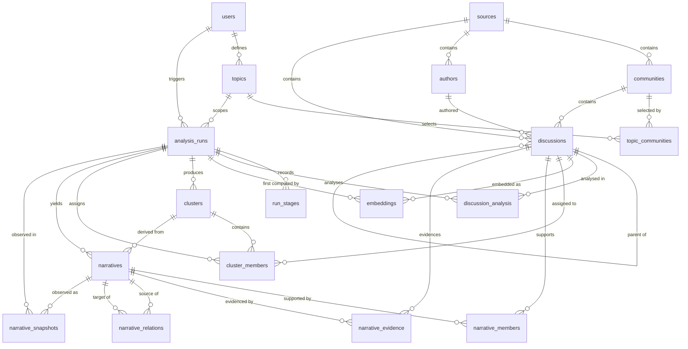

# NarraX Database

**Engine:** PostgreSQL 16 + `pgvector` · **Migrations:** Alembic · **Models:** `backend/app/database/models/`

This document covers the MVP schema: the ERD, every table's purpose, the design decisions
behind it, the findings from a senior-level review, and the rationale for each index.

Related: [architecture.md](architecture.md) · [data-flow.md](data-flow.md) ·
[epistemic-layers.md](epistemic-layers.md) · [data-safety.md](data-safety.md) ·
[ADR-0002](adr/0002-postgres-pgvector-single-datastore.md) ·
[ADR-0009](adr/0009-epistemic-layer-separation.md) ·
[ADR-0012](adr/0012-alembic-migrations.md) ·
[ADR-0014](adr/0014-operator-accounts.md)

---

## 1. Scope

18 tables: the 16 specified for the MVP plus two additions that are justified in §6.3 and
§6.4 (`topic_communities`, `run_stages`). Nothing else was added — evaluation reports, model
registries, and trend tables were deliberately **not** created (see §7.3).

| | |
|---|---|
| Primary keys | UUID (`gen_random_uuid()`, built into PostgreSQL 13+) |
| Timestamps | `timestamptz`, never naive |
| Derived rows | Append-only, versioned, provenance-bearing |
| Source truth | Immutable, written only by ingestion |
| Vector column | `vector(384)` |
| Referential integrity | 29 foreign keys, including 3 composite keys that enforce same-run membership |
| Constraints | 47 CHECK constraints, 19 unique constraints, 19 primary keys |

---

## 2. Entity-relationship diagram



### Layer overview

```text
Layer 0  operator identity      users

Layer 1  SOURCE TRUTH           sources ─┬─ communities        (a subreddit)
(immutable)                              ├─ authors            (pseudonymous handle)
                                         └─ discussions ── parent/child (posts + replies)
                selection metadata      topics ── topic_communities

Layer 2  ML OBSERVATIONS        discussion_analysis   (per run: corpus + sentiment + stance)
                                embeddings            (versioned, per model)
                                clusters ── cluster_members  (group + explicit noise)

Layer 3  AI INTERPRETATIONS     narratives ─┬─ narrative_members    (support base)
                                            ├─ narrative_evidence   (citations + rationale)
                                            └─ narrative_relations  (typed edges)

Layer 4  TEMPORAL OBSERVATIONS  narrative_snapshots   (per narrative, per run)

meta     RUN METADATA           analysis_runs ── run_stages
```

**The arrows only point one way.** Layers 4 → 3 → 2 → 1. Nothing in a derived table is ever an
input to acquisition, and only `ingestion/` writes Layer 1.

---

## 3. Conventions

| Convention | Choice | Why |
|---|---|---|
| Primary keys | UUID with **both** `default=uuid4` (Python) and `server_default=gen_random_uuid()` | The ORM gets an id without a round trip; raw SQL and bulk inserts still work |
| Timestamps | `timestamptz`, `server_default=now()` | Never store naive times — the corpus spans timezones and DST |
| Constraint names | Deterministic `MetaData(naming_convention=...)` | PostgreSQL would otherwise invent names, and a later migration cannot reliably target a constraint it cannot name |
| Controlled vocabularies | `text` + `CHECK` | Native `ENUM` needs `ALTER TYPE` to add a value, cannot reorder, and is awkward inside transactional migrations |
| Flexible metadata | `JSONB` in exactly 3 places | See §6.5 |
| Arrays | `text[]` for `topics.query_terms` | A simple list is not "flexible metadata" |

---

## 4. Table reference

### 4.1 Layer 0 — operator identity

| Table | Purpose | Notable constraints |
|---|---|---|
| `users` | The analyst operating NarraX. Accountable authorship of topics/runs. | `email` unique and lower-cased (CHECK), must contain `@` |

**Not to be confused with `authors`.** `users` are the people using the tool; `authors` are
pseudonymous people whose public posts were collected. The two tables never reference each
other, and no query joins them — that separation is the point
([ADR-0014](adr/0014-operator-accounts.md), [data-safety.md](data-safety.md)).

### 4.2 Layer 1 — source truth (immutable)

| Table | Purpose | Notable constraints |
|---|---|---|
| `sources` | A platform. Reddit only in the MVP. | `key` unique and lower-cased |
| `communities` | A community within a source (a subreddit). | unique `(source_id, external_id)` |
| `authors` | A pseudonymous handle. Deliberately holds **no other data**. | unique `(source_id, external_id)` |
| `discussions` | A post (`kind='post'`) or a reply (`kind='comment'`); `parent_discussion_id` forms the thread tree. | unique `(source_id, external_id)`; CHECKs: valid `kind`, a post has a `title`, a post is a root, no self-parent |
| `topics` | Selection criteria: name, terms, window, subreddits. | `name` unique; window ordering CHECK |
| `topic_communities` | Which communities a topic collects from. | unique `(topic_id, community_id)` |

**Author-authored fields are write-once.** Only NarraX-owned retrieval metadata
(`collected_at`) may be refreshed on re-ingestion; `body`, `title`, `source_created_at` and
`author_id` are never rewritten.

### 4.3 Run metadata

| Table | Purpose | Notable constraints |
|---|---|---|
| `analysis_runs` | One pipeline execution: topic, window, config snapshot, status, timings. | `status` vocabulary CHECK; `config` JSONB; window/finish ordering CHECKs |
| `run_stages` | One row per stage per run: status, counts, metrics, timings. | unique `(analysis_run_id, stage)`; `stage` and `status` vocabulary CHECKs; counts must add up |

### 4.4 Layer 2 — ML observations

| Table | Purpose | Notable constraints |
|---|---|---|
| `discussion_analysis` | A discussion's record **within one run** — also the run's corpus membership. Holds language, sentiment, stance. | unique `(analysis_run_id, discussion_id)`; label vocabularies; sentiment ∈ [-1,1]; stance confidence ∈ [0,1] |
| `embeddings` | One vector per `(discussion, model, model_version)`. Not run-scoped. | unique `(discussion_id, model_name, model_version)`; `dimensions = 384`; `vector(384)` |
| `clusters` | An opinion group produced by one run. | unique `(analysis_run_id, cluster_key)`; unique `(id, analysis_run_id)` — enables the composite FKs |
| `cluster_members` | A discussion's assignment within a run, **including explicit noise**. | unique `(analysis_run_id, discussion_id)`; composite FK to `clusters (id, analysis_run_id)`; `(cluster_id IS NULL) = is_noise` |

**Noise is not a cluster.** `is_noise = true` with a NULL `cluster_id` means "density-based
clustering declined to group this item". Modelling noise as a synthetic cluster would make
"clusters" mean two different things and would let the two fields disagree.

### 4.5 Layer 3 — AI interpretations

| Table | Purpose | Notable constraints |
|---|---|---|
| `narratives` | An LLM-extracted claim attributed to a group, from one run. Carries model + prompt version. | unique `(analysis_run_id, claim_hash)`, where `claim_hash` is a **generated column**; composite FK keeps its cluster in the same run; confidence ∈ [0,1]; claim/description/prompt version non-blank |
| `narrative_members` | Discussions attributed to the narrative (its support base). | unique `(narrative_id, discussion_id)` |
| `narrative_evidence` | Curated citations with `relevance` + `rationale`. | unique `(narrative_id, discussion_id)` |
| `narrative_relations` | Typed edges: `supports`, `contradicts`, `refines`, `co_occurs_with`. | unique `(from, to, type, inferred_by)`; no self-relation; `relation_type`/`inferred_by` CHECKs |

**Why `claim_hash` is generated in the database.** A unique constraint on `claim` itself would
build a b-tree over arbitrarily long text, which fails once a claim exceeds the index row limit.
A `sha256` fingerprint column (computed by PostgreSQL, not the application) gives the same
duplicate protection with a fixed 64-byte key.

**Why members and evidence are separate tables.** `narrative_members` answers *who the narrative
speaks for*; `narrative_evidence` answers *what proves it*. Keeping them apart means evidence can
be curated (a few strong citations) without losing the wider membership, and the publishability
rule ("no narrative without evidence") has something concrete to test.

### 4.6 Layer 4 — temporal observations

| Table | Purpose | Notable constraints |
|---|---|---|
| `narrative_snapshots` | A narrative's observed state at one point in time: member/evidence counts, share of corpus, direction. | unique `(narrative_id, analysis_run_id)`; composite FK pins the run to the narrative's own run; counts ≥ 0; share ∈ [0,1]; direction vocabulary |

Counts here are **the observation**, not a cache of a live table, so they are stored rather
than derived. First-seen and last-seen are *not* stored — they are `MIN(as_of)` / `MAX(as_of)`
over a narrative's snapshots, which avoids restating the same fact on every row.

---

## 5. Epistemic separation in the schema

[ADR-0009](adr/0009-epistemic-layer-separation.md) requires that source truth, ML observation,
AI interpretation, and temporal observation be structurally distinct. The schema enforces it
rather than relying on convention:

1. **Different tables per layer.** There is no row that is "half source text, half model output".
2. **Append-only by version.** Derived rows are keyed by *(unit, method, version)*. A new model
   version inserts new rows; it never rewrites the old ones.
3. **Mandatory provenance.** Every Layer 2/3/4 row references the run that produced it, and
   interpretations also record model and prompt version.
4. **Source truth is write-once, and only ingestion writes it.**
5. **A narrative cannot exist without evidence** — enforced in `services/` and asserted by tests,
   because a CHECK constraint cannot reference another table (§7.2).

**Verified by test:** deleting a topic removes its narratives and snapshots while leaving
`discussions` and `embeddings` intact (`test_topic_deletion_preserves_source_truth_and_text_observations`).
An embedding is a property of the text and the model, so it outlives the topic that motivated it.

---

## 6. Design decisions

### 6.1 UUID primary keys

Chosen so identifiers can be generated client-side, are safe to expose in URLs, and do not leak
corpus size. The cost is a larger index footprint than `bigint`; at MVP scale that is irrelevant,
and the alternative (sequential ids) would leak volume and complicate merging later runs.

### 6.2 `timestamptz` everywhere

`created_at`/`updated_at` use `timestamptz` with a `server_default`, so the database clock is the
single authority and a client with a wrong clock cannot corrupt ordering.

Two mixins exist deliberately:

- **`TimestampMixin`** (`created_at` + `updated_at`) — for rows that legitimately change:
  users, topics, sources, communities, authors, discussions, analysis runs, run stages,
  clusters, discussion analysis, narratives.
- **`CreatedAtMixin`** (`created_at` only) — for append-only rows: embeddings, cluster members,
  narrative members, narrative evidence, narrative relations, narrative snapshots, and the
  topic↔community join. An `updated_at` that can never change would advertise a mutability the
  data does not have.

### 6.3 `topic_communities` (added table)

A topic selects many communities and a community serves many topics — a many-to-many. The
alternatives were worse:

- `topics.community_ids uuid[]` — no foreign key, so references can dangle silently;
- duplicating community metadata onto the topic — denormalisation and drift.

The join table costs one row per pair and makes the relationship referentially sound.

### 6.4 `run_stages` (added table)

Resumability (FR-18/FR-20) and per-stage reporting (FR-19) need to know which stages of a run
completed and what they produced. Stored as JSONB on `analysis_runs`, that would lose the
`(run, stage)` uniqueness that makes "has this stage already run?" safe to answer. A table gives
it a constraint instead of a convention.

### 6.5 JSONB — only three uses

`JSONB` earns its place only where the shape is genuinely open:

| Column | Why JSONB |
|---|---|
| `discussions.raw_metadata` | Source-specific extras (flair, awards, edit state) that differ per platform and would otherwise force a migration per field |
| `analysis_runs.config` | The versioned configuration snapshot: model names/versions, clustering parameters, prompt versions — the set of keys grows as stages are added |
| `run_stages.metrics` | Per-stage counters, whose instrumentation improves over time |

Everything else is a typed column. In particular, **sentiment and stance are not JSONB**: they
are fixed, comparable, and constrained — exactly what a column plus a CHECK is for.

### 6.6 Controlled vocabularies as `text` + `CHECK`

Values live in `app/database/models/enums.py` as `StrEnum`s, and the CHECK is generated from the
same definition that the application imports, so database and code cannot drift. Native
PostgreSQL enums were rejected: adding a value requires `ALTER TYPE`, which cannot be reordered
or easily reversed, whereas a CHECK is replaced by dropping and re-adding one constraint.

### 6.7 Soft-delete: none

Facts are removed by cascading from their owner (a run, a topic, a narrative), not by
`deleted_at` flags. Nothing in the current read path needs to show "deleted" rows, and every
nullable-flag design costs a filter on every query. If retention or audit requirements appear,
that decision belongs in its own ADR.

---

## 7. Senior review findings

The schema was reviewed against: normalisation, foreign keys, cascades, uniqueness, nullability,
indexes, query patterns, pgvector usage, timestamp behaviour, data lifecycle, duplicate
prevention, and extensibility. Below is what was found — including what was **not** changed.

### 7.1 Problems found and fixed

| # | Finding | Fix |
|---|---|---|
| 1 | **`updated_at` on append-only tables.** Seven tables (embeddings, cluster members, narrative members, narrative evidence, narrative relations, narrative snapshots, topic↔community) carried an `updated_at` that no code path would ever change — a column advertising mutability that does not exist. | Added `CreatedAtMixin`; those tables now carry `created_at` only. `updated_at` count dropped from 18 tables to 11. |
| 2 | **Unconstrained stage vocabulary.** `run_stages.stage` was free text, so `"embedd"` would have been accepted and produced a phantom stage in run reports. | Added a `Stage` `StrEnum` and a CHECK. Renaming or adding a stage is now a deliberate, visible migration. |

Both fixes are in migrations `0002`/`0003` and are covered by tests
(`test_run_stage_name_is_constrained`, `test_expected_performance_indexes_exist`).

### 7.2 Residual issues, deliberately accepted

| # | Observation | Why it is acceptable now | Revisit when |
|---|---|---|---|
| 1 | **`narrative_snapshots` is effectively 1:1 with narratives.** Each run produces its own narrative rows, so a narrative has one snapshot. | The table is the Layer 4 record and is *shaped* for the target state; nothing depends on the cardinality. Cross-run narrative identity is Phase 6 work. | Cross-run narrative matching lands — the relationship becomes 1:N with no schema change |
| 2 | **`updated_at` is ORM-maintained**, not trigger-maintained. Hand-written SQL bypasses it. | Every write in the codebase goes through the ORM or SQLAlchemy Core, where `onupdate` applies. A trigger would add one function and 11 triggers for a path that does not exist. | Raw SQL writes are introduced, or `updated_at` becomes an audit requirement |
| 3 | **"No narrative without evidence" is not a database constraint.** A CHECK cannot reference another table. | Enforced in `services/` and asserted by tests; the alternative (a deferred constraint trigger) adds real complexity for a rule a single service owns. | A second writer to `narratives` appears |
| 4 | **`narratives.model_version` is nullable.** | Some providers do not expose a version. `prompt_version` — which *is* mandatory — is the lever NarraX controls, and `model_name` is always recorded. | A provider audit requires a pinned version (then make it NOT NULL) |
| 5 | **No GIN index on `raw_metadata`.** | It exists for provenance and fidelity, not for querying. Indexing it would cost write throughput for a query pattern nobody runs. | A feature queries source-specific metadata |
| 6 | **`embeddings.dimensions` duplicates `vector(384)`.** | Kept so a client can discover the dimensionality without reading `pg_type`; guarded by `CHECK (dimensions = 384)` so it cannot disagree. | A second embedding dimension is supported (then this becomes a real discriminator) |
| 7 | **Surrogate UUID on `topic_communities`**, rather than a composite primary key. | Consistency with the "UUID primary keys" convention; the natural key is still enforced by a unique constraint. | Never — it is a style choice with no correctness impact |
| 8 | **`discussion_analysis` doubles as the run's corpus record.** | Avoids a separate join table; a row means "this discussion is in this run", with observations filled in as stages complete. | Corpus selection and observation need independent lifecycles |

### 7.3 Things deliberately **not** added

- **No `models` registry table.** Model name/version live on the rows they produced. Provenance
  should be self-contained and immutable per row; a registry would introduce a join and a
  mutable indirection into an audit path.
- **No `narrative_trends` / `emerging_narratives` tables.** Both are derivable from
  `narrative_snapshots`. A stored trend is a cache that can drift from the observations it
  summarises.
- **No evaluation-results table.** Evaluation reports are run artifacts
  ([success-criteria.md §8](success-criteria.md)), not served product data.
- **No soft-delete columns, no audit/trigger tables, no denormalised counters.** Each was
  considered and rejected for the reasons above; "do not add unnecessary tables" is a real
  constraint, not a slogan.

### 7.4 Normalisation

The schema is in third normal form with three deliberate, documented exceptions:

| Denormalisation | Justification |
|---|---|
| `narrative_snapshots.member_count` / `evidence_count` | The count *is* the observation at that time; deriving it later would report today's membership against yesterday's claim |
| `clusters` unique `(id, analysis_run_id)` and `narratives` unique `(id, analysis_run_id)` | Redundant with the primary key, but required as a foreign-key target so children can prove same-run membership. Integrity wins over index minimalism |
| `embeddings.dimensions` | See §7.2 #6 |

---

## 8. Index rationale

**11 indexes** were added (`0003_performance_indexes.py`). PostgreSQL does **not** index foreign
keys automatically, so several of these exist to stop a delete from scanning a whole table —
that is a correctness-of-performance issue, not speculative tuning.

### 8.1 Created indexes

| Index | Columns | Query pattern it serves |
|---|---|---|
| `ix_analysis_runs_topic_id` | `topic_id` | "Runs for this topic" (the topic page); topic-delete cascade |
| `ix_discussions_community_created_at` | `community_id, source_created_at` | "Discussions by community" **and** chronological order within it — one index for both |
| `ix_discussions_source_created_at` | `source_created_at` | Chronological listing; the run-window filter (`BETWEEN`) every run applies |
| `ix_discussions_parent_discussion_id` | `parent_discussion_id` | Thread reconstruction (a post's replies); self-FK delete cascade |
| `ix_discussion_analysis_discussion_id` | `discussion_id` | A discussion's analyses across runs; discussion-delete cascade |
| `ix_cluster_members_cluster_id` | `cluster_id` | Cluster detail view (the members of a group); cluster-delete cascade |
| `ix_cluster_members_discussion_id` | `discussion_id` | Which groups a discussion belongs to; discussion-delete cascade |
| `ix_narrative_members_discussion_id` | `discussion_id` | Which narratives a discussion supports; discussion-delete cascade |
| `ix_narrative_evidence_discussion_id` | `discussion_id` | Where else a discussion is cited; discussion-delete cascade |
| `ix_narrative_relations_to_narrative_id` | `to_narrative_id` | Inbound edges ("what contradicts this narrative?"); narrative-delete cascade |
| `ix_embeddings_embedding_hnsw` | `embedding` (HNSW, `vector_cosine_ops`) | Vector similarity search |

### 8.2 Query patterns already covered — no index added

Half of the listed access patterns are served by an existing index whose **leading column** is
the filter. Adding a duplicate index would cost write throughput for nothing:

| Query pattern | Served by | Leading column |
|---|---|---|
| Discussions for an analysis run | `uq_discussion_analysis_run_discussion` | `analysis_run_id` |
| Discussions by source | `uq_discussions_source_external` | `source_id` |
| Clusters for an analysis run | `uq_clusters_run_key` | `analysis_run_id` |
| Members of a cluster (by run) | `uq_cluster_members_run_discussion` | `analysis_run_id` |
| Narrative retrieval for a run | `uq_narratives_run_claim` | `analysis_run_id` |
| Evidence retrieval for a narrative | `uq_narrative_evidence_pair` | `narrative_id` |
| Outbound narrative relations | `uq_narrative_relations_edge` | `from_narrative_id` |
| Narrative timeline (per narrative) | `uq_narrative_snapshots_pair` | `narrative_id` |
| Communities selected by a topic | `uq_topic_communities_pair` | `topic_id` |
| Run stages for a run | `uq_run_stages_run_stage` | `analysis_run_id` |

### 8.3 Columns deliberately left unindexed

| Column | Why not |
|---|---|
| `discussions.author_id` | Author-level queries are out of policy scope ([data-safety.md](data-safety.md)); authors are not deleted in normal operation. The cascade gap is accepted knowingly. |
| `topics.created_by_user_id`, `analysis_runs.triggered_by_user_id`, `embeddings.created_by_run_id` | Small tables or rare deletes; the probe cost is negligible. |
| `narratives.cluster_id`, `narratives.analysis_run_id` | A few dozen rows per run — a scan is cheaper than an index lookup. |
| `discussions.raw_metadata` | Never queried (see §7.2 #5). |
| `topics.query_terms` | Selection happens in Python over a handful of rows. |

### 8.4 pgvector usage

- The column is `vector(384)` — a **fixed dimension**, matching
  `EMBEDDING_DIMENSIONS` in `app/config/constants.py`.
- The index is **HNSW with cosine distance**, the standard metric for sentence embeddings, and
  works with pgvector ≥ 0.5 (the shipped `pgvector/pgvector:pg16` image and the pinned
  `pgvector` Python package both qualify).
- **Exact search is a legitimate alternative at MVP scale.** For a few thousand vectors a
  sequential scan is often as fast *and* exact; the planner will choose. The index exists so
  that growth does not require an outage, and it is cheap to maintain while small.
- Changing to a model with a different dimensionality **requires a migration** (the column type
  encodes the dimension). That is a deliberate constraint: silently mixing dimensions in one
  column would corrupt similarity search.

---

## 9. Data lifecycle

| Action | Effect |
|---|---|
| Delete a `source` | Cascades to its communities, authors, and discussions |
| Delete a `community` | Cascades to its discussions and topic links |
| Delete a `discussion` (a post) | Cascades to its replies, analyses, memberships, evidence, and embeddings |
| Delete an `author` | Discussions are **kept**, with `author_id` set to NULL |
| Delete a `topic` | Cascades to its runs, and through them to clusters, memberships, narratives, evidence, relations, and snapshots. **Source truth and embeddings survive.** |
| Delete an `analysis_run` | Cascades to stages, analyses, clusterings, narratives, and snapshots |
| Delete a `cluster` | Cascades to its memberships and the narratives derived from it |
| Delete a `narrative` | Cascades to its members, evidence, relations (both directions), and snapshots |
| Delete a `user` | Topics and runs are **kept**, with the owner set to NULL |

The pattern is consistent: **removing something removes what depends on it, and never removes
the source truth it was derived from.**

---

## 10. Migrations

| Revision | Contents |
|---|---|
| `0001_enable_pgvector` | `CREATE EXTENSION IF NOT EXISTS vector` |
| `0002_core_schema` | All 18 tables, constraints, and composite foreign keys |
| `0003_performance_indexes` | The 11 indexes in §8.1 |

Migrations are the only mechanism that changes the schema
([ADR-0012](adr/0012-alembic-migrations.md)). `0002` was produced by Alembic autogenerate from
the models and then hand-adjusted (explicit `pgvector` type import, house revision id), so the
models and the migrations cannot drift — a property the test suite verifies by running
`alembic check` semantics at build time.

```bash
cd backend
alembic upgrade head          # apply
alembic downgrade -1          # roll back one revision
alembic check                 # assert models and database agree
alembic revision --autogenerate -m "description"
```

---

## 11. How this schema is tested

`backend/tests/database/` runs against a **real PostgreSQL + pgvector** server:

- `NARRAX_TEST_DATABASE_URL` if set (CI, `docker compose`, an existing server), else
- `pgserver` — a pip-installable, self-contained server that needs no admin rights and no Docker
  (`pip install -e ".[dev,db-test]"`), else
- the tests **skip** with an explanatory message rather than failing.

70 database tests cover: source/community/author uniqueness, the discussion tree and its CHECKs,
topic and run creation, stage records, analysis records, embeddings (including a real cosine
similarity query and pgvector's dimension enforcement), clusters, cluster membership and the
same-run composite foreign key, narratives and the generated `claim_hash`, evidence, relations,
snapshots, every cascade, and the index contract itself.

```bash
cd backend
pytest tests/database -v
pytest                        # everything (API + config + database)
```
